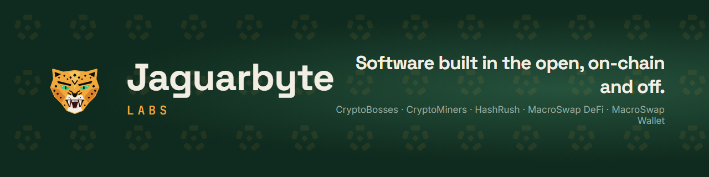

<h3 align="center">Software built in the open, on-chain and off.</h3>

We build on-chain games, DeFi and wallets, plus websites and apps for the regular web. Verified source, no hidden switches.

  
  

## What we do

- **Blockchain products.** Smart contracts, NFT collections, DeFi protocols, wallets and on-chain games on Ethereum.
- **Websites.** Fast, accessible, SEO-ready sites and landing pages, built to load in a blink.
- **Web and mobile apps.** Dashboards, SaaS tools, APIs and apps for the regular web, from idea to launch.

## What we build

| Project | What it is | Status | Links |
|---|---|---|---|
| **CryptoBosses** | ERC-721 collection: 10,000 islands of one archipelago. Each Boss is an island with its own biome, plots and title of land. | Live on Ethereum | [cryptobossesnft.com](https://cryptobossesnft.com) · [contract](https://etherscan.io/address/0x4958b779Bf6DB003DD87F67F0fc89d049d227C17) |
| **CryptoMiners** | ERC-721 game pass: One Miner, one game account. Art and seven traits are generated on-chain by the contract. | Live on Ethereum | [cryptobossesnft.com/#miners](https://cryptobossesnft.com/#miners) · [contract](https://etherscan.io/address/0xC7Aed3d7033c61112F52bFe9CBe842F15170f07c) |
| **HashRush** | Browser game: Build solar farms, reactors, chip factories and mining halls on your island. One-hour rounds, rooms of 100. | Playable now | [cryptobosses.xyz](https://cryptobosses.xyz) |
| **MacroSwap DeFi** | Non-custodial DeFi protocol: Buy-the-dip orders for Bitcoin and a fixed basket, on Ethereum and BNB Chain. Your funds stay in your wallet until a rule you set on-chain executes. Not a promise of returns. | Live on Ethereum and BNB Chain | [macroswap.finance](https://macroswap.finance) · [contract](https://etherscan.io/address/0xB60e34a0edB0f73E83A8704E56141e12618184C1) |
| **MacroSwap Wallet** | Self-custody browser wallet: One recovery phrase for Ethereum, BNB Chain and Solana, with Ledger support, clear approval prompts and MacroSwap orders built in. Your keys never leave your device. | In development | [macroswap.finance](https://macroswap.finance) |

## How we work

- **Immutable by design.** No proxies, no upgrade keys. What is deployed is what runs.
- **Verified source.** Every contract is published on Etherscan under the MIT license.
- **No hidden switches.** Reward contracts have no owner, pause or team withdrawal.
- **Checked twice, signed once.** Rounds settle only when independent price sources agree.

## Team

**[Vini do Carmo](https://github.com/vinidocarmo)**, Founder & CTO 
Full-Stack Developer · Software Engineer 
Builds the contracts, games and tooling at Jaguarbyte Labs. Previously Tech Analyst and President at CryptoJR, UFSC (Federal University of Santa Catarina).

 

## Stack

`Solidity` · `Foundry` · `Hardhat` · `Slither` · `Aderyn` · `Rust` · `AWS` · `AWS Lambda` · `Node.js` · `Three.js` · `SvelteKit` · `viem` · `WalletConnect` · `Cloudflare` · `Ethereum` · `BNB Chain` · `Solana`

## Work with us

Websites, apps, smart contracts or a product idea? Write to [contact@jaguarbytelabs.com](mailto:contact@jaguarbytelabs.com), visit [jaguarbytelabs.com](https://jaguarbytelabs.com) or find us on [LinkedIn](https://www.linkedin.com/company/jaguarbyte-labs).

---

Nothing we publish about crypto is financial advice or a promise of value. · [jaguarbytelabs.com](https://jaguarbytelabs.com) · [LinkedIn](https://www.linkedin.com/company/jaguarbyte-labs)
